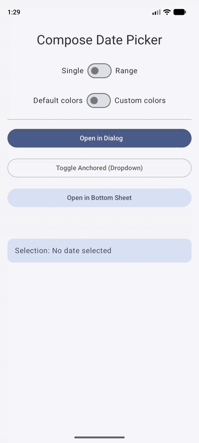
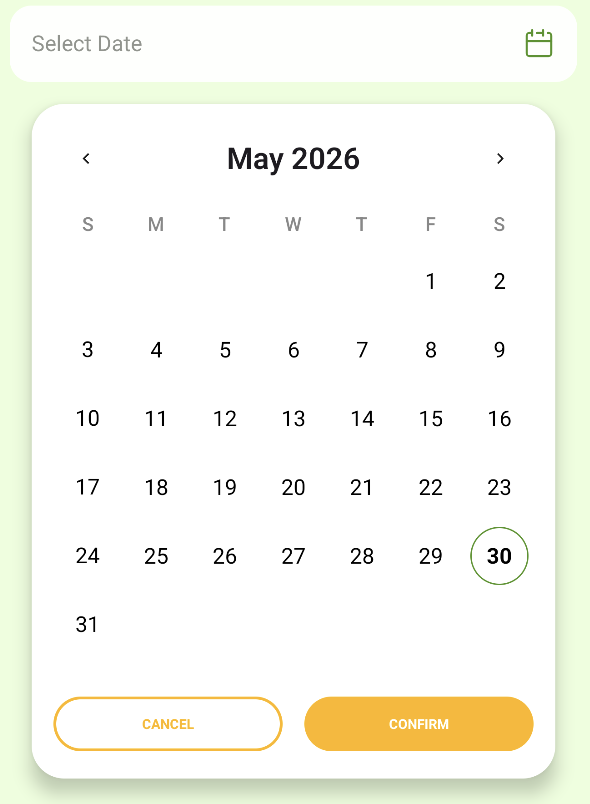
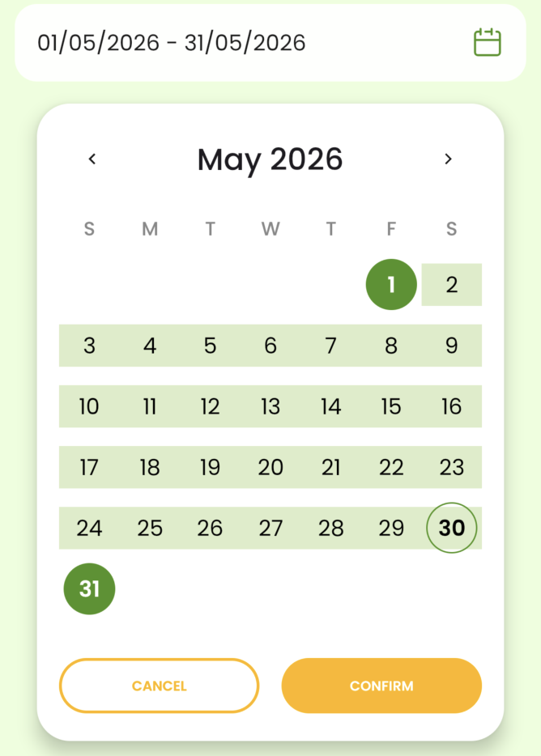

# ComposeDatePicker

[](https://central.sonatype.com/artifact/dev.mikelau/compose-datepicker)
[](https://opensource.org/licenses/Apache-2.0)

A lightweight, customizable Date Picker for Jetpack Compose and Compose Multiplatform, built with Material 3.

## Features

- 📅 **Single Date Selection**: Simple and intuitive date picking.
- ↔️ **Range Date Selection**: Easy start and end date selection with range highlighting.
- 🎨 **Material 3**: Designed with modern Material 3 components and principles.
- 🌍 **Compose Multiplatform**: Ready for Android and iOS.
- 🧾 **Bottom Sheet**: Scrolling month-by-month calendar in a swipe-to-dismiss bottom sheet.
- 🛠️ **Customizable**: Background, text, selection, range start/end and range highlight alpha colors.

## Installation

The library is available on **Maven Central**. Add the repository to your `settings.gradle.kts` if not already present:

```kotlin
dependencyResolutionManagement {
    repositories {
        google()
        mavenCentral()
    }
}
```

|Sample App|Android|iOS|
|--|--|--|
||||

### Android (Kotlin DSL)

Add the dependency to your module's `build.gradle.kts`:

```kotlin
dependencies {
    implementation("dev.mikelau:compose-datepicker-android:1.1.0")
}
```

### Kotlin Multiplatform (KMP)

In your shared module's `build.gradle.kts`:

```kotlin
kotlin {
    sourceSets {
        commonMain.dependencies {
            implementation("dev.mikelau:compose-datepicker:1.1.0")
        }
    }
}
```

### Version Catalog (`libs.versions.toml`)

```toml
[versions]
composeDatePicker = "1.1.0"

[libraries]
compose-datepicker = { group = "dev.mikelau", name = "compose-datepicker", version.ref = "composeDatePicker" }
```

Then in `build.gradle.kts`:

```kotlin
commonMain.dependencies {
    implementation(libs.compose.datepicker)
}
```

## Requirements

- **Android**: minSdk 24+
- **Kotlin**: 2.0+
- **Compose Multiplatform**: 1.6+
- **Targets**: Android, iOS (arm64, simulatorArm64)

## Usage

### Single Date Selection

```kotlin
val state = remember { DatePickerState(selectionMode = DatePickerState.SelectionMode.Single) }

ComposeDatePicker(
    state = state,
    onConfirm = { confirmedState ->
        println("Selected date: ${confirmedState.selectedDate}")
    },
    onCancel = { /* Handle cancel */ }
)
```

### Range Date Selection

```kotlin
val state = remember { DatePickerState(selectionMode = DatePickerState.SelectionMode.Range) }

ComposeDatePicker(
    state = state,
    onConfirm = { confirmedState ->
        println("Selected range: ${confirmedState.rangeStart} to ${confirmedState.rangeEnd}")
    },
    onCancel = { /* Handle cancel */ }
)
```

### Customizing Colors

#### Quick (all versions)

The three original color parameters still work exactly as before:

```kotlin
ComposeDatePicker(
    primaryColor = Color(0xFF6200EE), // selected day, range start/end, today outline
    accentColor = Color(0xFF03DAC6),  // confirm / cancel buttons
    rangeColor = Color(0xFFBB86FC),   // range highlight band
    onConfirm = { /* ... */ }
)
```

#### Full control (1.1.0+)

Pass `colors` to customize the calendar background, text, start/end highlights and range highlight alpha. This applies to every `ComposeDatePicker` usage — inside a `Dialog`, an anchored `Popup` dropdown, or inline:

```kotlin
ComposeDatePicker(
    state = state,
    colors = ComposeDatePickerDefaults.colors(
        containerColor = Color(0xFF1E1D22),      // calendar background
        monthTitleColor = Color.White,
        navigationIconColor = Color.White,       // previous / next month arrows
        dayOfWeekTextColor = Color(0xFFA1A1AA),
        dayTextColor = Color(0xFFD4D4D8),
        todayTextColor = Color.White,
        todayOutlineColor = Color(0xFFFFB547),
        inRangeDayTextColor = Color(0xFFD4D4D8),
        selectedDayTextColor = Color.White,
        selectedDayColor = Color(0xFFFFB547),    // Single mode
        rangeStartColor = Color(0xFFFFB547),
        rangeEndColor = Color(0xFFFFB547),
        rangeHighlightColor = Color(0xFFFFB547),
        rangeHighlightAlpha = 0.2f,              // multiplied into rangeHighlightColor's alpha
        confirmButtonColor = Color(0xFFFFB547),
        confirmButtonTextColor = Color.White,
        cancelButtonColor = Color(0xFFFFB547),   // outline + text
    ),
    onCancel = { /* ... */ },
    onConfirm = { /* ... */ }
)
```

Every parameter is optional — override only what you need; the rest keep the original look. You can also combine both styles: `ComposeDatePickerDefaults.colors(primaryColor = ..., accentColor = ..., rangeColor = ...)` seeds the defaults the same way the legacy parameters do.

> **Migrating:** no changes are required. If you don't pass `colors`, the picker looks identical to previous versions, and `primaryColor` / `accentColor` / `rangeColor` keep working. When `colors` is passed, it takes precedence over those three parameters.

### Bottom Sheet (1.1.0+)

A scrolling, month-by-month calendar inside a modal bottom sheet. Supports both Single and Range selection via `DatePickerState.selectionMode`. There is no cancel button — swipe down to dismiss; tap **Done** to confirm.

```kotlin
var showSheet by remember { mutableStateOf(false) }

if (showSheet) {
    ComposeDatePickerBottomSheet(
        state = remember { DatePickerState(selectionMode = DatePickerState.SelectionMode.Range) },
        confirmText = "Done",
        colors = DatePickerBottomSheetDefaults.colors(
            containerColor = Color(0xFF1E1D22),
            dayTextColor = Color(0xFFD4D4D8),
            rangeStartColor = Color(0xFFFFB547),
            rangeEndColor = Color(0xFFFFB547),
            rangeHighlightColor = Color(0xFFFFB547),
            rangeHighlightAlpha = 0.2f,
            selectedDayColor = Color(0xFFFFB547), // Single mode
        ),
        onDismissRequest = { showSheet = false },
        onConfirm = { state ->
            println("Selected range: ${state.rangeStart} to ${state.rangeEnd}")
            showSheet = false
        }
    )
}
```

Other options: `firstDayOfWeek` (default Monday), `monthsBefore` / `monthsAfter`, `maxHeightFraction`, `monthTitle` and `dayOfWeekLabel` formatters.

## DatePickerState

`DatePickerState` provides access to the current selection:

- `selectedDate`: The currently selected `LocalDate` (Single mode).
- `rangeStart`: The start of the selected range (Range mode).
- `rangeEnd`: The end of the selected range (Range mode).
- `currentMonth`: The month currently being displayed in the picker.

## Dependencies

- [Kotlinx Datetime](https://github.com/Kotlin/kotlinx-datetime)
- Jetpack Compose / Compose Multiplatform (Material 3)

## License

```
Copyright 2026 Mike Lau

Licensed under the Apache License, Version 2.0 (the "License");
you may not use this file except in compliance with the License.
You may obtain a copy of the License at

    http://www.apache.org/licenses/LICENSE-2.0
```
